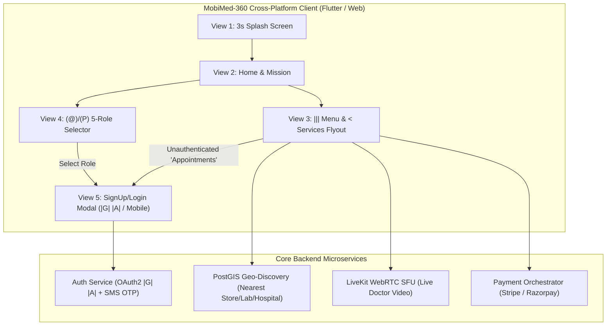

# Technical Requirements Document (TRD) — MobiMed-360

## 1. Technology Stack Selection (Evaluated via Jev AI — 96% Confidence)

| Layer | Technology | Rationale |
| :--- | :--- | :--- |
| **Cross-Platform Client** | **Flutter 3.x (Dart)** + Impeller Engine | Compiles AOT to native ARM64/x64 machine code for Android, iOS, Windows, macOS, Linux, and Web from a single lightweight codebase. |
| **State Management & Routing** | **Riverpod 2.x + GoRouter** | Declarative route guards (`Appointments` auth redirect to View 5 Login Modal) and reactive state for the 5 user roles. |
| **Real-Time Video (Live Consult)** | **LiveKit / WebRTC (`flutter_webrtc`)** | Adaptive bitrate HD video/audio consultations with low-bandwidth fallback for 3G/4G networks. |
| **Backend API & Auth** | **Node.js (Fastify/NestJS) or Supabase** | High-throughput REST + WebSocket APIs, OAuth2 (`|G|` Google, `|A|` Apple), and Mobile OTP verification. |
| **Geospatial Database** | **PostgreSQL 16 + PostGIS** | Fast `ST_DWithin` spatial queries to locate the **nearest medical store**, **nearest pathology lab**, and **nearest hospital**. |
| **Payment Gateways** | **Stripe + Razorpay SDK** | Native PCI-DSS compliant checkout for UPI, Cards, Apple Pay, Google Pay, and NetBanking. |

---

## 2. System Architecture Diagram

---

## 3. Non-Functional & Lightweight Performance Requirements

1. **Lightweight Footprint**
   * Android APK (split-per-abi): $\le 7.5\text{ MB}$.
   * iOS IPA compressed size: $\le 9.0\text{ MB}$.
   * Memory footprint at idle: $< 65\text{ MB}$ RAM.
2. **3-Second Splash Timer (`First View`)**
   * Splash screen must pre-warm authentication tokens and geolocation coordinates in parallel and automatically dismiss at exactly $t = 3000\text{ ms}$.
3. **Geolocation & Nearest Discovery**
   * Uses device GPS (`geolocator`) with IP-geolocation fallback to sort Medi-Stores, Pathology Labs, and Hospitals by road distance (km) and estimated delivery/arrival time.
4. **Offline Resilience**
   * Local SQLite/Hive cache stores past E-Prescriptions, downloaded Pathology PDF reports, and upcoming appointment tickets for offline viewing.
