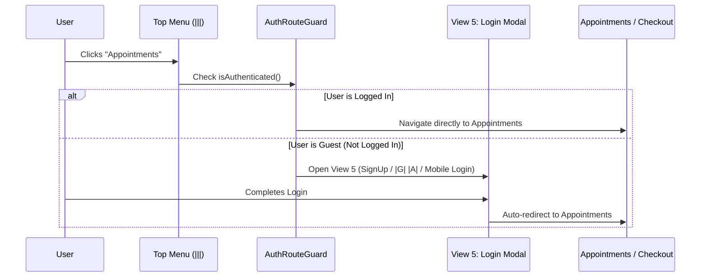

# Security & Access Control Specification — MobiMed-360

## 1. Authentication Flows (`Fifth View` Spec)

MobiMed-360 supports passwordless and federated authentication inside the unified SignUp/Login Modal:

1. **Google OAuth 2.0 (`|G|`)**
   * Uses PKCE (Proof Key for Code Exchange) flow on mobile and web.
   * Exchanges Google ID token for a short-lived MobiMed JWT (`15m` expiry) + rotating Refresh Token (`30d` expiry).
2. **Apple Sign-In (`|A|`)**
   * Mandatory for iOS App Store compliance whenever third-party OAuth is offered.
   * Supports Apple private email relay and biometric FaceID/TouchID confirmation.
3. **Mobile Number + OTP (`Mobile Number`)**
   * E.164 phone number validation + rate-limited 6-digit SMS/WhatsApp OTP (max 3 attempts per 10 minutes, 60-second resend cooldown).
4. **Secure Token Storage**
   * Mobile: Stored in hardware-backed Android Keystore / iOS Keychain (`flutter_secure_storage`).
   * Web: Stored in `HttpOnly`, `Secure`, `SameSite=Strict` cookies.

---

## 2. Route Guard Policy (`Third View` Spec)

As specified in **Third View**:
> *"Appointments — If login then open, otherwise ask to login"*

### Public vs. Protected Routes
* **Public (Guest Browsing Allowed):**
  * `First View` (Splash), `Second View` (Home & Mission), `About`, `Support`, browsing `Services > Doctors`, `Services > Medi-store`, `Services > Pathology`, `Services > Hospitals`.
* **Protected (Requires Login via View 5 Modal):**
  * `Appointments` (viewing/joining live doctor calls)
  * `Checkout & Payment` (placing medicine, lab, or hospital orders)
  * Role Dashboards (`Doctor`, `Hospital`, `Pathology`, `Medi-Store` portals)

---

## 3. Role-Based Access Control (RBAC) Matrix (`Fourth View` `(P)` Menu)

| Resource / Action | `Patient` | `Doctor` | `Hospital` | `Pathology` | `Medi-Store` |
| :--- | :---: | :---: | :---: | :---: | :---: |
| Browse Doctors, Stores, Labs & Hospitals | ✅ | ✅ | ✅ | ✅ | ✅ |
| Book Appointment & Join Live Video Call | ✅ (Self) | ✅ (Assigned) | ❌ | ❌ | ❌ |
| Issue Digital E-Prescription (`Rx`) | ❌ | ✅ | ❌ | ❌ | ❌ |
| View / Verify Patient Prescription (`Rx`) | ✅ (Own) | ✅ | ✅ | ❌ | ✅ (Order Rx) |
| Upload Verified Lab Report PDF | ❌ | ❌ | ✅ | ✅ | ❌ |
| Update ICU / Bed & OPD Availability | ❌ | ❌ | ✅ | ❌ | ❌ |
| Manage Pharmacy Stock & Dispatch Rider | ❌ | ❌ | ❌ | ❌ | ✅ |

---

## 4. Healthcare Data Compliance & Encryption
* **Encryption in Transit:** TLS 1.3 for all REST APIs; DTLS-SRTP end-to-end encryption for all Live Doctor WebRTC video/audio streams.
* **Encryption at Rest:** AES-256 encryption for prescriptions, pathology PDF reports, and patient medical history.
* **Payment Security:** Zero raw card storage on MobiMed servers; tokenized payment intents via PCI-DSS Level 1 providers (Stripe / Razorpay).
