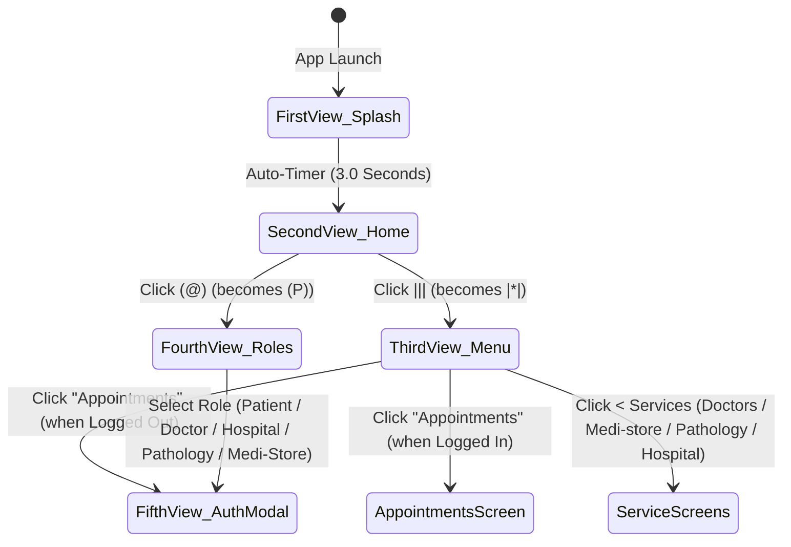

# Front-End Architecture & UI Specification — MobiMed-360

## 1. Exact Wireframe-to-Component Mapping

```
+---------------------------------------------------+
| MobiMed-360                            (@)  |||   |  <-- Persistent Top AppBar
+---------------------------------------------------+
```

### Header Bar Interactive States
1. **Brand Title (`MobiMed-360`)**: Clicking anywhere on `MobiMed-360` returns the user to **Second View (Home)**.
2. **Role / Profile Trigger (`(@)` $\leftrightarrow$ `(P)`)**:
   * Default icon: `(@)`
   * Active/Open icon (`Fourth View`): `(P)`
   * Opens the **Role Selector Dropdown**:
     * `> Patient`
     * `> Doctor`
     * `> Hospital`
     * `> Pathology`
     * `> Medi-Store`
3. **Hamburger Menu Trigger (`|||` $\leftrightarrow$ `|*|`)**:
   * Default icon: `|||`
   * Active/Open icon (`Third View`): `|*|`
   * Opens the **Primary Navigation Dropdown** with cascading **`< Services`** flyout:
     ```
                   | Home
      !!!!!!     < | Services
     |Doctors      | Appointments  <-- Auth Guarded!
     |Medi-store   | About
     |Pathology    | Support
     |Hospital/etc | etc
     ```

---

## 2. View Lifecycle & State Machine



---

## 3. Flutter Widget Tree & Folder Structure

```text
lib/
├── main.dart                        # Entry point, 3-sec Splash, AppState & 5 Wireframe Views
├── core/
│   ├── auth_guard.dart              # Intercepts 'Appointments' & 'Checkout' if unauthenticated
│   └── theme.dart                   # Material 3 Healthcare Theme & Dark/Wireframe Mode
├── widgets/
│   ├── mobimed_app_bar.dart         # MobiMed-360 header with (@)/(P) and |||/|*| menus
│   ├── services_cascade_menu.dart   # Third View: Home, < Services flyout, Appointments, About, Support
│   ├── role_dropdown_menu.dart      # Fourth View: > Patient, > Doctor, > Hospital, > Pathology, > Medi-Store
│   └── auth_signup_modal.dart       # Fifth View: SignUp, |G| |A|, Mobile Number, Login
└── features/
    ├── splash/                      # First View: 3-second auto-disappearing Welcome screen
    ├── home/                        # Second View: Mission statement & nearest service discovery
    ├── doctors/                     # Global Doctors & Live WebRTC Video Consultation room
    ├── medistore/                   # Nearest Medi-Store catalog, Rx upload & express cart
    ├── pathology/                   # Nearest Pathology lab booking & smart PDF report viewer
    ├── hospital/                    # Nearest Hospital online services, OPD & ICU bed tracker
    └── checkout/                    # Unified multi-payment gateway (UPI, Card, Wallet, COD)
```
