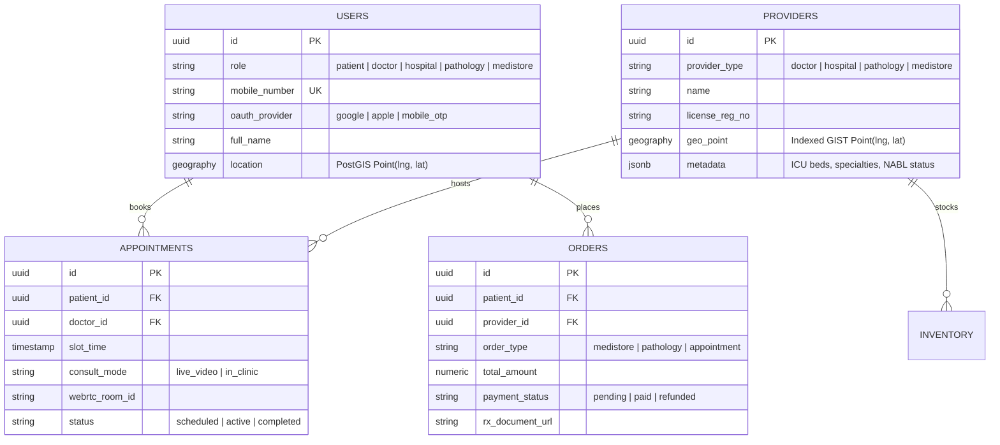

# Backend Architecture & API Specification — MobiMed-360

## 1. Database Schema (PostgreSQL + PostGIS)



---

## 2. Nearest Provider Geospatial Query (PostGIS)

To fulfill the **Second View** requirement (*"purchase the medicine online the nearest medical store & find the nearest pathology & online services from Hospital"*), the backend executes an indexed spatial query:

```sql
SELECT
  id,
  name,
  provider_type,
  metadata,
  ROUND((ST_Distance(geo_point, ST_MakePoint($1, $2)::geography) / 1000.0)::numeric, 2) AS distance_km
FROM providers
WHERE provider_type = $3 -- 'medistore' | 'pathology' | 'hospital'
  AND ST_DWithin(geo_point, ST_MakePoint($1, $2)::geography, 15000) -- within 15 km radius
ORDER BY geo_point <-> ST_MakePoint($1, $2)::geography
LIMIT 20;
```

---

## 3. Core REST & WebSocket API Endpoints

### Authentication (`Fifth View`)
* `POST /api/v1/auth/oauth` — Verify Google (`|G|`) or Apple (`|A|`) ID token and return JWT + Role profile.
* `POST /api/v1/auth/otp/send` — Dispatch 6-digit OTP to `mobile_number`.
* `POST /api/v1/auth/otp/verify` — Verify OTP and issue session token for selected role (`Patient`, `Doctor`, `Hospital`, `Pathology`, `Medi-Store`).

### Discovery & Services (`Second View` & `Third View`)
* `GET /api/v1/doctors?specialty=&global=true` — List global doctors available for live consultation.
* `GET /api/v1/nearby?type=medistore|pathology|hospital&lat=&lng=` — Return nearest medical stores, pathology labs, and hospitals sorted by distance.

### Protected Appointments & Live WebRTC (`Third View` Auth-Guarded)
* `GET /api/v1/appointments` *(Requires Bearer JWT)* — List active patient or doctor appointments.
* `POST /api/v1/appointments/:id/live-token` *(Requires Bearer JWT)* — Generate encrypted LiveKit/WebRTC room token for live video consultation.

### Unified Checkout & Payments
* `POST /api/v1/checkout/create-intent` *(Requires Bearer JWT)* — Create Stripe/Razorpay payment intent for combined Medi-Store, Pathology, and Doctor Appointment items.
